  

# 🛍️ Awesome Retail Omnichannel CRM Ecosystem 🚀

  
  
  
  
  

---

## 🌟 Executive Overview & SEO Index

Welcome to the ultimate curated directory of **Retail Omnichannel CRM Platforms**, **Customer Data Platforms (CDPs)**, **Headless Commerce Engines**, and **Point of Sale (POS) Systems**. Designed for enterprise IT architects, e-commerce managers, and retail tech founders, this repo tracks commercial SaaS leaders and self-hosted open-source stacks that drive unified customer journeys across online storefronts, mobile apps, and physical retail locations.

> 🔍 **Primary Keywords**: *Retail Omnichannel CRM, Open Source Commerce Platform, Headless E-Commerce, Customer Data Platform (CDP), Point of Sale (POS) Integration, AI Retail Personalization, Self-Hosted CRM, Customer 360 Unification.*

---

## 📑 Table of Contents

- [🏢 SaaS & Hosted Commercial Platforms](#-saas--hosted-commercial-platforms)
- [💻 Open-Source GitHub Projects](#-open-source-github-projects)
- [🤝 How to Contribute](#-how-to-contribute)
- [⭐ Star History](#-star-history)
- [💖 Support & Sponsorship](#-support--sponsorship)
- [⚠️ Disclaimer & License](#%EF%B8%8F-disclaimer--license)

---

## 🏢 SaaS & Hosted Commercial Platforms

> 📈 **Market Intelligence**: The global Retail Omnichannel CRM & Commerce Software sector is valued at **$12.5 Billion** and projected to reach **$28.4 Billion** by 2030 (CAGR ~15.2%). The sector is **moderately fragmented**, bridging legacy enterprise software titans (Salesforce, SAP, Adobe) with modern composable MACH commerce ecosystems (Shopify, commercetools) and specialized AI personalization platforms.

| Product | 🏢 Company Size / Revenue / Valuation | 💰 Starting Tier Price | 🎁 Free Tier / Trial Limit | 📝 Strategic Summary & Best Use Cases |
| :--- | :--- | :--- | :--- | :--- |
| **[Shopify Plus](https://www.shopify.com/plus)** | **~$305.4B** Valuation ($11.6B Revenue) | **$2,300/mo** | 3-day free trial + 3 months at $1/mo (Standard); custom demo for Plus | **Enterprise e-commerce platform** — omnichannel selling, customer accounts, and marketing automation with extensive app ecosystem. **Best for high-growth DTC brands**. |
| **[SAP Commerce Cloud](https://www.sap.com/)** | **~$240.7B** Valuation ($43.3B Revenue) | **~$150,000/yr** (Custom contract) | No free trial; interactive demo on request | **Enterprise commerce platform** — omnichannel retail with deep SAP ERP integration. **Best for SAP-centric retailers**. |
| **[Salesforce Retail Cloud](https://www.salesforce.com/)** | **~$188.6B** Valuation ($41.5B Revenue) | **$25/user/mo** (Starter Suite) / **$165/user/mo** (Enterprise) | 30-day free trial (no credit card required) | **Salesforce's retail industry CRM** — unified customer profiles, order management, loyalty programs, and personalized engagement across channels. **Best for enterprise retailers**. |
| **[Adobe Commerce](https://business.adobe.com/products/magento/magento-commerce.html)** | **~$102.8B** Valuation ($23.0B+ Revenue) | **~$22,000/yr** (Based on gross merchandise value) | No free trial (Open-source Magento version is free self-hosted) | **Enterprise e-commerce platform** (formerly Magento) — B2B and B2C commerce with personalization. **Best for large retailers**. |
| **[Bloomreach](https://www.bloomreach.com/)** | **~$2.2B** Valuation ($260M+ ARR) | **~$60,000/yr** (Custom quote) | No free trial; custom live demo available | **Commerce experience platform** — AI-powered product discovery, content, and personalization. **Best for retail personalization**. |
| **[commercetools](https://commercetools.com/)** | **~$1.9B** Valuation (Private) | **~$50,000/yr** (Custom consumption pricing) | 60-day free developer trial account | **Composable commerce platform** — API-first, MACH architecture for omnichannel retail. **Best for enterprises wanting flexibility**. |
| **[VTEX](https://vtex.com/)** | **~$603M** Valuation ($240.5M Revenue) | **~$250/mo** + revenue share (Custom quote) | 14-day trial / sandbox environment available | **Composable commerce platform** — marketplace, omnichannel, and B2B capabilities for global retailers. **Best for Latin American and global retailers**. |
| **[BigCommerce Enterprise](https://www.bigcommerce.com/)** | **~$342.3M** Revenue (Commerce.com) | **$29/mo** (Standard) / **~$1,000/mo** (Enterprise custom quote) | 15-day free trial (no credit card required) | **Open SaaS e-commerce platform** — headless commerce, B2B features, and omnichannel capabilities. **Best for mid-market and enterprise retailers**. |
| **[Dynamic Yield](https://www.dynamicyield.com/)** | **Mastercard Subsidiary** (Acquired) | **~$35,000/yr** (Custom quote) | No free trial; interactive sandbox demo | **Personalization and recommendation platform** — real-time optimization for e-commerce. **Best for enterprise personalization**. |
| **[Kibo Commerce](https://kibocommerce.com/)** | **Private Enterprise** | **~$40,000/yr** (Custom usage-based pricing) | No free trial; interactive sandbox demo upon request | **Composable commerce platform** — order management, personalization, and subscription capabilities. **Best for omnichannel retailers**. |

---

## 💻 Open-Source GitHub Projects

| Repository & Link | ⭐ GitHub Stars | 🏷️ Category & Architecture | ⚡ Technical Features & Key Highlights |
| :--- | :--- | :--- | :--- |
| **[Twenty](https://github.com/twentyhq/twenty)** |  | Customer Relationship Management | **Modern open-source CRM with Notion-like interface and GraphQL API**. Built on TypeScript, React, and NestJS. Features customizable object schemas, kanban pipelines, email integration, and full data control under AGPL-3.0. |
| **[Odoo](https://github.com/odoo/odoo)** |  | Enterprise ERP, CRM & Commerce | **Open-source suite of business apps**, LGPL-3.0 licensed. Fully integrated CRM, Point of Sale (POS), e-commerce, inventory management, and marketing automation for omnichannel retailers. |
| **[Medusa](https://github.com/medusajs/medusa)** |  | Headless Commerce Engine | **Open-source Node.js headless commerce engine** (Shopify alternative), MIT licensed. Features multi-region support, automated order management, pluggable payment/shipping modules, and extensible POS starter kit. |
| **[Bagisto](https://github.com/bagisto/bagisto)** |  | E-Commerce & Marketplace | **Open-source Laravel e-commerce framework**, MIT licensed. Features built-in multi-inventory sources, localized stores, B2B portal, multi-vendor marketplace, and mobile app integration. |
| **[Krayin CRM](https://github.com/krayin/laravel-crm)** |  | Customer Relationship Management | **Free & open-source Laravel CRM solution for SMEs and Enterprises**, MIT licensed. Features Kanban visual lead tracking, customizable fields, ACL role-based permissions, and activity management. |
| **[Saleor](https://github.com/saleor/saleor)** |  | Headless Omnichannel Commerce | **High-performance, open-source headless e-commerce platform**, GraphQL-native API. Features multi-channel routing, multi-warehouse inventory, PWA storefronts, and 160+ webhooks. Used by Lush and Breitling. |
| **[Spree](https://github.com/spree/spree)** |  | Commerce & Omnichannel Platform | **Open Source Platform for DTC, B2B Commerce, Marketplaces & Omnichannel**, BSD 3-Clause licensed. Includes React Admin Dashboard, Next.js Storefront, multi-region routing, and channel attribution. |
| **[WooCommerce](https://github.com/woocommerce/woocommerce)** |  | E-Commerce Platform | **Open-source e-commerce platform built on WordPress**, GPL-2.0 licensed. Extensive plugin ecosystem for POS integration, customer management, inventory sync, and multi-channel fulfillment. |
| **[EspoCRM](https://github.com/espocrm/espocrm)** |  | Customer Relationship Management | **Free, open-source self-hosted CRM**, AGPLv3 licensed. Track contacts, manage deals, handle support cases with customer portals, run email campaigns, and configure custom layouts without code. |
| **[Fat Free CRM](https://github.com/fatfreecrm/fat_free_crm)** |  | Customer Relationship Management | **Open-source Ruby on Rails CRM platform**, MIT licensed. Features team collaboration, lead management, opportunity tracking, contact lists, and elegant user experience. |
| **[Tracardi](https://github.com/Tracardi/tracardi)** |  | Customer Data Platform (CDP) | **API-First Composable Open-source Customer Data Platform Engine**, MIT licensed. Ingests, models, and unifies customer data from web/mobile touchpoints to personalize user experiences in real time. |
| **[Uyuni for Retail](https://github.com/uyuni-project/uyuni)** |  | Retail Infrastructure Operations | **Open-source retail infrastructure management platform**, GPL-2.0 licensed. Manages image deployment, PXE boot, Salt state automation, and monitoring across distributed POS terminals and branch servers. |
| **[LiteCart](https://github.com/litecart/litecart)** |  | Lightweight E-Commerce | **Lightweight open-source e-commerce platform**, free license. Features modular structure, Stripe and PayPal integrations, fast loading performance, and Docker/Kubernetes deployment support. |
| **[Liberu Ecommerce](https://github.com/liberusoftware/ecommerce-laravel)** |  | Modular E-Commerce | **Modular e-commerce platform built on Laravel, Livewire & Filament**. Includes reactive shopping cart, Stripe/PayPal checkout, dropshipping integration, customer segmentation, and abandoned cart recovery. |
| **[LEO CDP](https://github.com/trieu/leo-cdp-framework)** |  | AI Customer Data Platform | **Open Source AI-first Customer Data Platform framework**, Apache-2.0 licensed. Features omnichannel data collection, Real-Time Customer 360, RFM analysis, dynamic audience segmentation, and predictive scoring. |
| **[RealTimeX CRM](https://github.com/therealtimex/realtimex-crm)** |  | Privacy-First CRM | **Full-featured privacy-first CRM**, Bring Your Own Database (Supabase) configuration. Includes contact management, task reminders, email logging, Kanban deal pipelines, and SSO authentication. |

---

## 🤝 How to Contribute

Contributions are highly welcome! Please follow these guidelines:

1. 🍴 **Fork the Repository** to your GitHub account.
2. 📝 **Add or Modify Entries** in `README.md` following the tabular format.
3. 🔍 **Provide Accurate Details**: Name, official link, category, star badge, and factual description.
4. 🚀 **Submit a Pull Request** with a detailed summary of your additions.

Explore more curated open-source lists at [Awesome-Awesome-Awesome](https://github.com/ishandutta2007/Awesome-Awesome-Awesome).

---

## 📈 Star History

---

## 💖 Support & Sponsorship

If you find this repository valuable for your retail tech stack or enterprise architectural research, please consider supporting the project!

- ⭐ **Star this repository** to improve its visibility on GitHub.
- 🔄 **Fork and Share** with fellow engineers, developers, and architects.
- ☕ **Buy Me a Coffee / Sponsor**: Support ongoing maintenance via [GitHub Sponsors](https://github.com/sponsors/ishandutta2007).

---

## ⚠️ Disclaimer & License

- **Disclaimer**: This list is community-curated for informational purposes only and does not constitute formal financial or architectural endorsement.
- **Data Compliance**: Retail omnichannel CRM platforms process sensitive customer data. Ensure strict adherence to GDPR, CCPA, and PCI-DSS compliance standards.
- **License**: Distributed under the MIT License.
